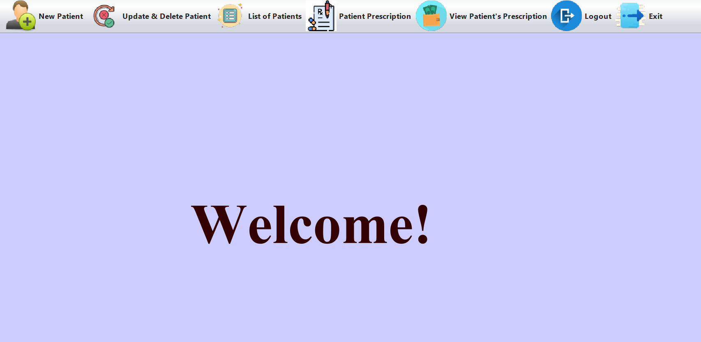
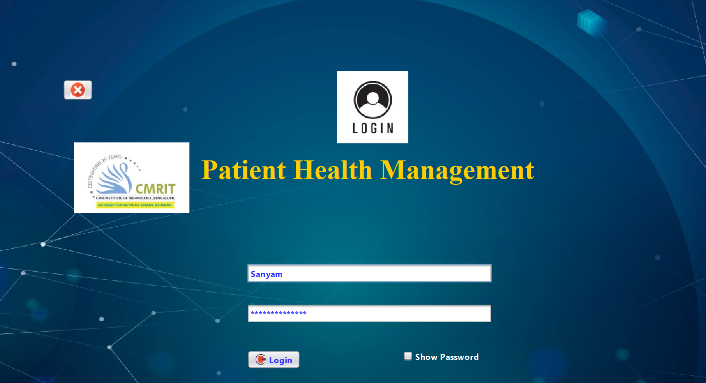
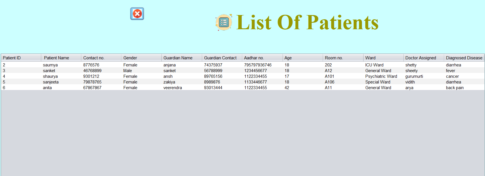
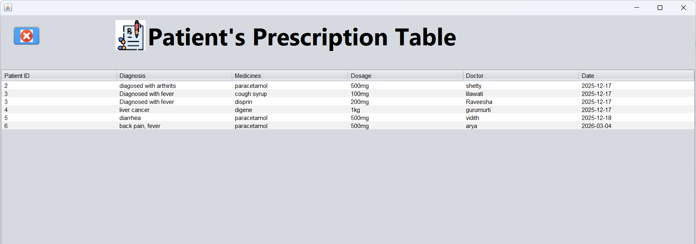
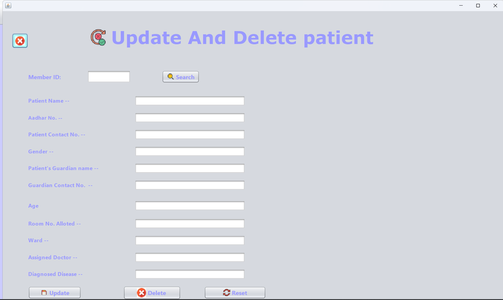

# Patient Health Record Management System

A desktop-based healthcare management application built using **Java, Java Swing, MySQL, JDBC, and Apache NetBeans** to simplify patient record management, prescription handling, and payment tracking.

## 📸 Screenshots

### Home Page


### Login Page


### Patient Information & Prescription


### Patient List


### Patient Prescription


### Update Patient


## ✨ Features

- Patient registration and record management
- View, update, and delete patient records
- Prescription management
- Payment record management
- MySQL database integration using JDBC
- Java Swing desktop interface

## 🛠️ Technologies Used

- Java
- Java Swing
- MySQL
- JDBC
- Apache NetBeans
- Git and GitHub

## ⚙️ Setup

1. Install Java JDK, Apache NetBeans, and MySQL Server.
2. Clone this repository:

   ```bash
   git clone https://github.com/Sanyam-main/Patient-Health-Record-Management-System.git
   ```

3. Open the project in Apache NetBeans.
4. Create the `project` database and the tables required by the application.
5. Configure MySQL Connector/J and set the `DB_PASSWORD` environment variable to your local MySQL password.
6. Build and run the application from NetBeans.

**Security:** Never commit database passwords or real patient information.

## 👨‍💻 Author

**Sanyam Pareek**

[GitHub Profile](https://github.com/Sanyam-main)
